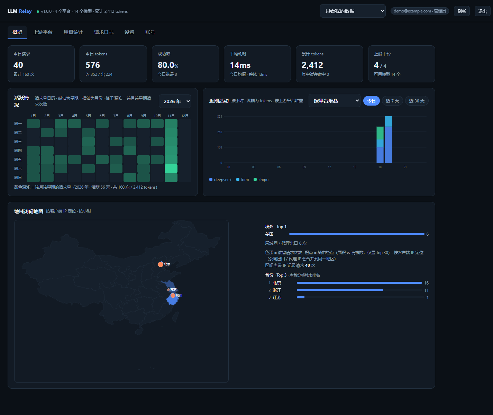
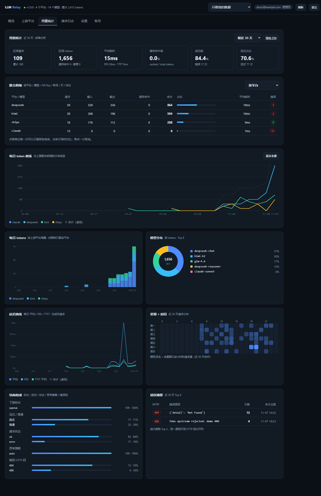
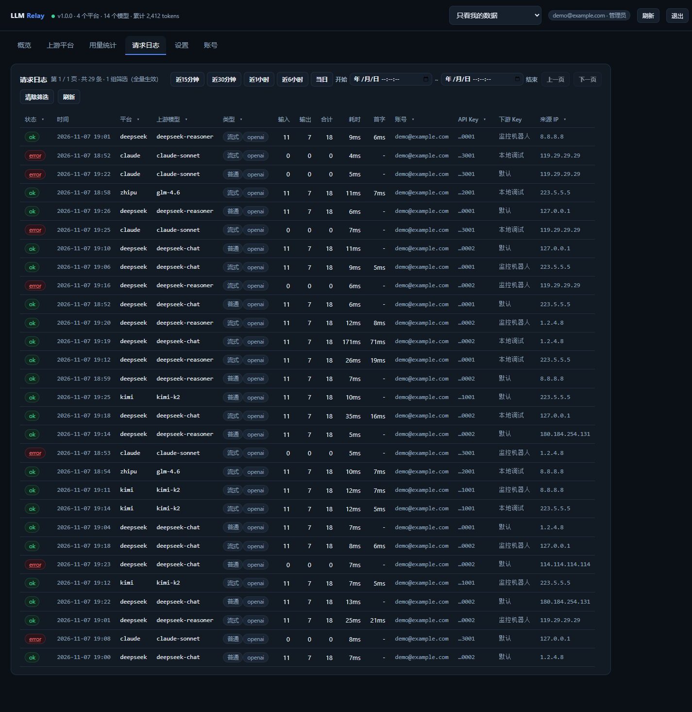
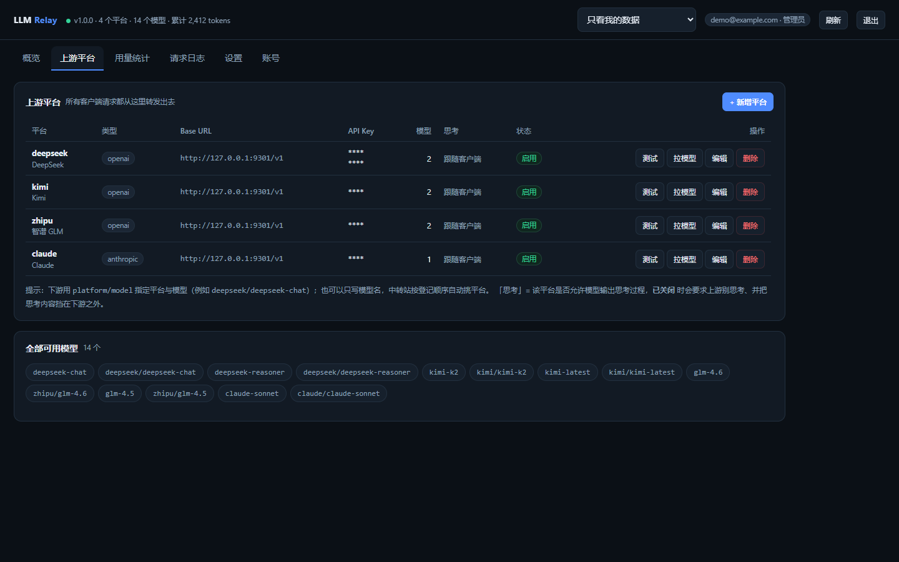
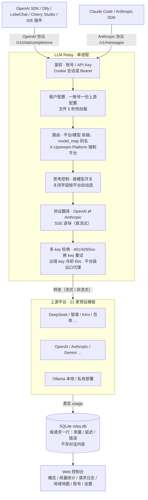

# LLM Relay · 本地 LLM token 中转站

> [](LICENSE)
> [](https://www.python.org/)
> []

> 下游客户端统一指向本机一个地址，中转站按 `平台/模型` 把请求转发到各家上游平台，
> 并把**每个平台、每个模型的 token 用量**记进本地 SQLite，自带网页控制台看统计。
> 基于 FastAPI + httpx + SQLite，无重型依赖，单进程即可跑。

<p align="center">
  
  
  
  
</p>

## 为什么做

* LLM模型平台太多，托管到第三方怕key被偷偷盗用。
* 一段时间在各个平台的大模型上到底会用多少token，有个汇总的统计。
* 平台账户limit限制了切换key麻烦，想多个key自动轮询避免超限。
* 作者在用byterover记录agent记忆的时候不想麻烦的去专门选无思考模型，平台上关闭模型思考加快检索速度。
* 有些国外的AI平台国内无法访问，或者访问太慢，想找个国际机服务器中转一下。
* 换不同的agent客户端的时候，不想再把各大上游llm平台再重新配置一遍。
LLM Relay 这些事情本地化：
客户端只要改一个 `base_url`，
就能同时用上所有上游平台，用量按账号、平台、模型分得清清楚楚。

## 项目特点

| # | 能力 | 一句话说明 |
| --- | --- | --- |
| 1 | **双协议 × 双协议** | 下游 OpenAI 或 Anthropic 客户端，上游 OpenAI 兼容或 Anthropic 原生，4 种组合自动翻译 |
| 2 | **真流式** | SSE 逐块转发，首字延迟不被缓冲；客户端断开自动收尾 |
| 3 | **精确 token 统计** | 主动向上游索取 usage（流式也一样），拿不到才估算并标 `est` |
| 4 | **多 key 轮换 + 冷却** | 同一平台可配多个 key（如各家的免费模型额度），401/429/5xx 自动换 key 重试、出错 key 冷却 60s——一个 key 额度用完自动切下一个，客户端无感、不被 limit 卡死 |
| 5 | **按模型关思考** | 模型级开关，关闭字段按平台自动选（Ollama / 智谱 / 百炼 … 各有写法） |
| 6 | **多账号隔离** | 邮箱密码注册登录，各账号独立上游配置 / API Key / 用量；管理员可跨账号查看 |
| 7 | **Web 控制台** | 增删平台、一键拉模型、连通性测试、用量曲线；单文件前端、无 CDN 依赖 |
| 8 | **部署灵活** | 裸跑 / Nginx / Caddy / Cloudflare Tunnel / 子目录部署 / 网关自跑 HTTPS，真实 IP 还原入库 |
| 9 | **下游 key 备注 + 过期** | 客户端 key 可设备注与过期时间（默认永久）；日志/用量/概览按备注名统计，过期 key 访问即 401（报错带实际过期时间）；吊销/禁用 key 同样 401，过期与禁用事件都会写进请求日志（带下游 key 归属） |
|10 | **只转发对话不截消息**| 只记录请求状态与失败报错，不截留任何租户信息用以模型训练 |

## 架构一览



一句话：**客户端 → 鉴权/路由/翻译/换 key → 上游平台**，用量记账进 SQLite，控制台全读它。
模块细节、设计决策（为什么单进程 / 为什么 usage 精确优先 / 热加载语义）和容量实测见 [docs/ARCHITECTURE.md](docs/ARCHITECTURE.md)。

## 1. 快速开始

```bash
# 获取代码
git clone <仓库地址> llm-relay
cd llm-relay

# 首次：建 venv、装依赖（Windows 也可以直接双击 start.bat，会自动做这两步）
uv venv
uv pip install -r requirements.txt        # 或：pip install -r requirements.txt

# 启动（会打印控制台地址，默认 http://127.0.0.1:8800）
python run.py
```

打开 <http://127.0.0.1:8800/>，**注册第一个账号**（自动成为管理员），
之后在「设置 → 我的 API Key」里建 Key 给客户端用。

登录后：**上游平台 → + 新增平台 → 选预设 → 填 API Key → 保存 → 拉模型**。

> 端口 / 监听地址用环境变量覆盖：`RELAY_PORT`、`RELAY_HOST`。

## 2. 下游客户端怎么接

下游只要支持 OpenAI 或 Anthropic 协议，把 base_url 指到中转站就行，**不用改代码**。

```bash
# OpenAI 兼容（OpenAI SDK / Cherry Studio / ChatBox / Dify / LobeChat / IDE 插件…）
OPENAI_BASE_URL=http://127.0.0.1:8800/v1
OPENAI_API_KEY=«redacted:sk-…»

# Anthropic 兼容（Claude Code / Anthropic SDK…）
ANTHROPIC_BASE_URL=http://127.0.0.1:8800
ANTHROPIC_AUTH_TOKEN=«redacted:sk-…»
```

`~/.claude/settings.json`：

```json
{
  "env": {
    "ANTHROPIC_BASE_URL": "http://127.0.0.1:8800",
    "ANTHROPIC_AUTH_TOKEN": "«redacted:sk-…»"
  }
}
```

### 路由规则（怎么"选上游平台和模型"）

请求体里的 `model` 字段决定去哪儿：

| 写法 | 含义 |
| --- | --- |
| `deepseek/deepseek-chat` | 指定平台 `deepseek` + 该平台的模型 `deepseek-chat` |
| `deepseek-chat` | 只写模型名，按配置顺序挑第一个登记过它的平台 |
| 任意 `model` + 请求头 `X-Upstream-Platform: zhipu` | 强制走某个平台，`model` 去掉前缀后使用 |

`GET /v1/models` 会同时列出 `平台/模型` 和裸模型名（含别名），客户端下拉框里能直接选。

## 3. 支持的下游接口

| 方法 | 路径 | 说明 |
| --- | --- | --- |
| POST | `/v1/chat/completions` | OpenAI 协议对话，流式 / 非流式 |
| POST | `/v1/completions` | 旧版补全（透传） |
| POST | `/v1/embeddings` | OpenAI 兼容上游透传 |
| POST | `/v1/messages` | Anthropic 协议对话，流式 / 非流式 |
| POST | `/v1/messages/count_tokens` | Anthropic 上游代理；OpenAI 上游本地估算 |
| GET | `/v1/models` | 聚合所有平台的模型；带 `anthropic-version` 头时返回 Anthropic 形状 |
| GET | `/healthz` | 健康检查 |

鉴权：`Authorization: Bearer *** 或 `x-api-key: ***
管理 API（`/api/*`）完整清单见 [docs/DEEP_DIVE.md](docs/DEEP_DIVE.md)。

## 4. 上游平台配置

配置文件 `config/upstreams.json`（控制台改的就是它，改完 5 秒内自动热加载）：

```json
[
  {
    "platform": "deepseek",
    "name": "DeepSeek",
    "type": "openai",
    "base_url": "https://api.deepseek.com/v1",
    "api_keys": ["sk-aaa", "sk-bbb"],
    "models": ["deepseek-chat", "deepseek-reasoner"],
    "enabled": true,
    "timeout_s": 300
  }
]
```

常用字段：

- `type`：`openai`（OpenAI 兼容，含所有第三方兼容网关）或 `anthropic`（Messages 原生）
- `base_url`：**不要**带 `/chat/completions`。OpenAI 兼容平台通常要含版本前缀（`.../v1`、`.../compatible-mode/v1`）
- `api_keys`：多 key 轮换；出错（401/429/5xx）的 key 冷却 60 秒
- `models`：控制台「拉模型」会自动填，也可以手写
- `model_map`：**模型别名表**，`{ "下游看到的名字": "上游真实名字" }`，换上游模型不用改客户端：

  ```json
  "model_map": {
    "fast":  "deepseek-chat",
    "smart": "deepseek-reasoner"
  }
  ```

  | 客户端请求的 `model` | 实际发给上游 | 说明 |
  | --- | --- | --- |
  | `deepseek/fast` | `deepseek-chat` | 带平台前缀，最明确 |
  | `fast` | `deepseek-chat` | 裸别名，按配置顺序找第一个声明了它的平台 |
  | `fast` + 请求头 `X-Upstream-Platform: deepseek` | `deepseek-chat` | 强制平台 + 别名 |

  别名会自动出现在 `GET /v1/models` 里（`fast` 和 `deepseek/fast` 都列出来），客户端下拉框能直接选。
  别名**不需要**再写进 `models`；`models` 只影响「裸模型名路由」和模型列表展示。

  > 注意：`platform/xxx` 带前缀的写法**不校验** `xxx` 是否登记在 `models` 里——前缀命中平台就直接转发，
  > 方便临时试新模型；但也意味着打错字会变成上游 404，而不是网关的 404。

- `extra` 高级项：`chat_path` / `messages_path` / `models_path` / `count_tokens_path` 覆盖默认路径、
  `headers` 额外请求头、`anthropic_version` / `anthropic_beta` Anthropic 版本头、
  `default_max_tokens`（OpenAI→Anthropic 转换时补的必填项）、
  `inject_stream_usage`（流式时主动向上游要 usage，默认 true）

> `config/upstreams.json` 里是明文 key，已在 `.gitignore` 里，别提交。

## 5. 思考 / 推理控制（按模型关掉思考）

**只有模型级开关**。平台默认永远是「跟随客户端」——客户端传 `reasoning_effort` / `thinking`
就照传，不传就不加。控制台「编辑平台」→「模型级思考设置」里每个模型可设
`off / low / medium / high / 跟随客户端`，选 `off` 时再选发给上游的关闭字段
（默认「自动」＝按平台挑，规则抄自 Hermes 各 provider profile）：

| 平台 | 关闭时自动发给上游 |
| --- | --- |
| Ollama | `reasoning_effort:"none"` + `think:false` |
| 智谱 / z.ai / GLM | `thinking:{"type":"disabled"}`（GLM-5.3 关不掉 → 降 `reasoning_effort:"low"`） |
| DeepSeek 官方 | `thinking:{"type":"disabled"}` |
| Kimi / Moonshot | `thinking:{"type":"disabled"}`（与 reasoning_effort 互斥） |
| 通义 / DashScope / 硅基 | `enable_thinking:false` |
| Gemini | `extra_body.google.thinking_config.thinking_budget=0` |
| OpenRouter / 其它 OpenAI 兼容 | `reasoning_effort:"none"` |
| Anthropic 原生 | 省略 `thinking`（该协议没有 disabled 类型） |

「关闭」改的是**发给上游的请求字段本身**：先清掉客户端传来的所有思考字段，
再按平台显式写入关闭字段——客户端强行开思考也会被覆盖。
实测数据、`thinking_off` 模式全表、各平台关闭能力一览见 [docs/DEEP_DIVE.md](docs/DEEP_DIVE.md#思考控制详解)。

## 6. 账号与多租户

控制台用**邮箱 + 密码**登录：

- 库里一个账号都没有 → 登录框切成「注册」，**第一个注册的账号自动成为管理员**
  （豁免邮箱确认，注册即可登录），并接管改造前的历史用量记录和
  `config/upstreams.json` 里的上游配置；
- 之后的账号都是普通账号，注册后先进入**待确认（pending）**状态：
  系统往其邮箱发一封含**确认链接（magic link）**的邮件——链接内是
  「邮箱 + 时间戳」的 HMAC 签名，**30 分钟内**点击才有效；
  服务端校验签名、时效与邮箱一致后账号激活（active）并发放默认 API Key，
  未确认前无法登录、没有 Key；登录页可「重发确认邮件」（60 秒间隔、每日 5 次）；
- 之后的账号**配置与用量互相看不到**。

邮件发送支持两种模式（不配 SMTP 时默认日志模式，确认链接打进服务器日志
`[mail/log]`，便于内网 / 无邮箱环境引导首个用户）。**推荐在控制台
「设置 → 邮箱发信设置」页面上配置**（仅管理员，含发测试邮件按钮），
页面保存的配置优先于环境变量：

| 环境变量 | 说明 |
| --- | --- |
| `RELAY_MAIL_MODE` | `smtp` / `log`（缺省：配了 `RELAY_SMTP_HOST` 用 smtp，否则 log） |
| `RELAY_SMTP_HOST` / `RELAY_SMTP_PORT` | SMTP 服务器（端口缺省 587，STARTTLS 开） |
| `RELAY_SMTP_USER` / `RELAY_SMTP_PASS` | SMTP 账号密码 / 授权码（可选） |
| `RELAY_SMTP_FROM` | 发件人（可选） |

> 确认链接的域名取请求的 `Host`（`base_url`），反代场景下就是公网地址，无需额外配置。
> 注意：**用什么地址注册，链接里就是什么域名**——本机 `localhost:8800` 注册得到的
> 链接只有本机能打开（手机 / 网页邮箱客户端点开会走它们的外链保护网关而失败，
> 属正常现象）；想让手机直接可点，请通过公网地址（域名 / 反代）注册。

生命周期与安全：

- 确认链接 30 分钟有效（HMAC 签名 + 时间戳，防篡改防枚举）；**pending 账号
  注册后 30 分钟内没点确认链接会被自动清理**（邮箱随之释放，可直接重新注册；
  账号管理页的「删除」按钮可随时手动清掉某个待确认账号）。
- 重发确认邮件限频（同一邮箱 60 秒间隔、每日 5 次）；对不存在的邮箱返回
  统一话术，不泄露账号是否存在。
- 管理员在「账号」页可以**彻底删除**某个账号（会话 / API Key / 用户行一并删除，
  请求历史保留作审计）；自己与最后一个活跃管理员不可删。

| 能力 | 普通账号 | 管理员 |
| --- | --- | --- |
| 自己的上游平台 / key | ✅ 增删改 | ✅ 只对自己名下的 |
| 自己的用量报表 / 日志 / 曲线 | ✅ | ✅ |
| 别人的数据 | ❌ | ✅ 顶部「数据视角」：只看我的 / 全部账号 / 指定账号 |
| 「账号」页（建号、禁用、改密、改角色） | ❌ | ✅ |

每个账号有独立的 API Key（`sk-relay-…`），下游客户端用它鉴权，
网关据此决定用谁的上游配置、把用量记到谁名下。Key 支持多把、可吊销；
明文只在创建/注册时返回一次，列表里只显示掩码。

```
配置文件：config/tenants/u<账号id>/upstreams.json   （一个账号一份）
用量库  ：data/relay.db 的 requests.user_id 列
会话    ：Cookie（HttpOnly, SameSite=Lax, 7 天），也可以直接 Bearer 调 /api
```

## 7. 用量统计

每条请求一行，落在 `data/relay.db` 的 `requests` 表。核心字段：

| 字段 | 说明 |
| --- | --- |
| `ts` / `request_id` | 时间、请求 ID（响应头 `x-request-id` 同一个） |
| `platform` / `model` / `model_alias` | 上游平台 / 上游真实模型名 / 下游请求里写的原始 model |
| `in_format` / `stream` / `status` / `error` | 下游协议（openai/anthropic）、流式标记、成功/失败、错误摘要 |
| `prompt_tokens` / `completion_tokens` / `total_tokens` | 用量（优先取上游真实 usage） |
| `cached_tokens` / `reasoning_tokens` | 缓存命中 / 思维链 token |
| `estimated` | 1 = 上游没给 usage，本值是估算 |
| `latency_ms` / `ttft_ms` | 总耗时 / 首字延迟 |
| `client_ip` | 来源 IP（挂反代时是 `X-Forwarded-For` 还原出来的真实 IP） |
| `reasoning_policy` | 这次请求实际生效的思考策略（`off`/`auto`/`low`/…） |
| `key_hint` / `key_index` | 这次用的是平台里哪个 API Key（打码）及其序号 |

完整字段表见 [docs/DEEP_DIVE.md](docs/DEEP_DIVE.md#用量统计字段全表)。

控制台「用量统计」可按 **平台 / 平台+模型 / 模型 / 天 / 下游协议 / 下游 key** 聚合（管理员多一个 **按账号**），可导出 CSV。「下游 key」按客户端 key 的**备注名**统计（无备注/已删除/历史未记录分别归为「(无备注)」「(key 已删除)」「(未记录)」）。概览「近期活动」支持按平台 / 模型 / 下游 key 堆叠；请求日志多一列「下游 Key」。
概览页另有「**地域访问地图**」：按 `client_ip` 定位请求来源（中国到省、境外到国家、私有段算「局域网/代理出口」），
颜色深浅 = 该省请求数，省图上叠加**城市热点圆点**（面积 ∝ 该城请求数，取 Top 30；城市名自动转中文），跟随概览的时间范围 chip（今日/7 天/30 天）。
定位走**双离线库**：中国段优先 IP2Region `IP2Region.xdb`（开源免费、精确到城市+运营商，免费 GeoLite2 对国内家宽/运营商 IP 常常只到国家级），境外与未命中落 MaxMind `GeoLite2-City.mmdb`；
两者都是**可选配置**：把文件放入 `data/`（或设 `RELAY_GEOIP_DB` / `RELAY_IP2REGION_XDB` 指向）即生效，全不配置时该面板显示配置提示、其余功能不受影响（详见 DEPLOY.md §8）。
直接查 SQL 也行：

```sql
SELECT platform, model, SUM(prompt_tokens), SUM(completion_tokens), SUM(total_tokens)
FROM requests WHERE ts >= date('now','-7 day') GROUP BY platform, model;
```

## 8. 目录结构

```
llm-relay/
├── app/
│   ├── main.py          # /v1/* 入口 + 控制台托管
│   ├── gateway.py       # 转发核心：发送、重试、4 种协议组合、记账
│   ├── translate.py     # OpenAI <-> Anthropic 请求/响应/SSE 双向翻译
│   ├── registry.py      # 上游注册表：路由、多 key 轮换、模型探测
│   ├── tenants.py       # 多租户：一账号一份上游配置
│   ├── auth.py          # 账号体系：邮箱+密码、会话、每账号 API Key
│   ├── storage.py       # SQLite 用量存储 + 聚合查询（自动加列迁移）
│   ├── admin.py         # 管理 API + 21 家上游预设
│   ├── mailer.py        # 邮箱确认（magic link，SMTP / 日志双模式）
│   ├── geoip.py         # 双 GeoIP 库定位（IP2Region xdb + GeoLite2 mmdb）
│   ├── ip2xdb.py        # IP2Region xdb 纯 Python 二进制解析（零依赖）
│   ├── reasoning.py     # 思考控制：按模型开关 + 按平台选关闭字段
│   ├── config.py        # 路径 / 超时
│   └── static/index.html  # 控制台（单文件，无 CDN 依赖）
├── docs/DEEP_DIVE.md    # 思考控制实测、实现要点、完整字段与 API 参考
├── docs/ARCHITECTURE.md # 架构：模块图、请求流、设计决策、容量规划
├── docs/screenshots/    # 控制台截图（假数据脱敏）
├── tests/               # 真 HTTP 假上游 + 端到端门禁（离线可跑）
├── deploy/              # nginx.conf.example / caddy.Caddyfile / certs 说明
├── config/settings.example.json  # 运行时设置样例（拷贝为 settings.json 改）
├── data/relay.db        # 用量库（首次启动自动创建）
├── LICENSE              # MIT
├── CHANGELOG.md
├── CONTRIBUTING.md
├── run.py  start.bat  requirements.txt
├── Dockerfile  docker-compose.yaml   # 部署：服务器 / WSL 两条路线（见 DEPLOY.md）
└── make_release.sh      # 打部署包（代码包 + 可选状态包）
```

## 9. 测试

```bash
pip install -r requirements-dev.txt        # 或 uv pip install -r requirements-dev.txt
python -m pytest -q
```

测试**完全离线**：在本机起一个真实的假上游（同时提供 OpenAI 和 Anthropic 两套接口），
用真 HTTP 打通整个链路，不需要任何真实 API Key。覆盖：鉴权、四种协议组合的
流式/非流式、工具调用翻译、usage 精确落库、est 降级、错误透传、统计聚合、
key 轮换、平台 CRUD。

## 10. 支持的上游平台

控制台内置 **21 家预设模板**（「新增平台」下拉框直接选，自动填 base_url / 协议 / 模型）：

DeepSeek、硅基流动、Kimi / Moonshot、智谱 GLM、阿里百炼 / DashScope、OpenRouter、
OpenAI 官方、Anthropic 官方、Agnes apihub、本地 Ollama、魔塔（ModelScope 推理）、
HuggingFace（Inference）、Nous Research（Inference）、NVIDIA NIM（Build）、
Google AI Studio（Gemini）、火山方舟（豆包）、阶跃星辰（StepFun）、
讯飞星火（Spark）、MiniMax、xAI（Grok）、Mistral。

其他 OpenAI 兼容 / Anthropic 原生网关均可**自定义**接入（填 base_url + 模型即可）。
想加新厂商？按 [CONTRIBUTING.md](CONTRIBUTING.md#新增上游平台预设) 提 PR。

## 11. FAQ

**Q：「拉模型」成功但「测试」报 402 / 402 payment required？**
A：是上游**计费**不是配置错。典型如 HuggingFace Inference：`/v1/models` 拉清单免费永远能过，
但真实推理需要账号预充 credits / PRO 额度；网关只是透传。换平台或充值即可。

**Q：流式回复一下一下地蹦（首字延迟暴涨）？**
A：反代没关 buffering。Nginx `proxy_buffering off`、Caddy `flush_interval -1`，
完整四项配置见 [DEPLOY.md §二](DEPLOY.md#二反向代理配置)。

**Q：地域访问地图空白 / 只显示「中国大陆（未解析到省）」？**
A：没放 GeoIP 库，或库覆盖度问题。免费 GeoLite2 对国内家宽/运营商 IP 常只到国家级；
放 `data/IP2Region.xdb`（开源免费，中国精确到城市）即解决，步骤见 [DEPLOY.md §8](DEPLOY.md#8-地域访问地图可选双-geoip-库)。

**Q：能横向扩多副本 / 多进程吗？**
A：不能。统计库是 SQLite 单写者、key 冷却状态在进程内存，必须单进程（见 [DEPLOY.md §四](DEPLOY.md#四容量规划与部署注意)）。
要横向扩需换 Postgres + Redis。

**Q：第二个账号注册后登录不了 / 没有 Key？**
A：第二个及以后的账号需点邮件里的**确认链接（30 分钟有效）**才激活。
没配 SMTP 时链接打进服务器日志（`[mail/log]`），手动打开即可。

## 12. 安全须知

- **公网暴露**：务必设 `RELAY_CORS_ORIGINS=https://你的域名` 收紧跨域；
  各账号的 API Key 是明文中转凭证，别提交进客户端代码仓库。
- **证书 / key 目录**：`config/upstreams.json`、`config/tenants/`、`data/` 含明文
  key 与账号数据，生产上 `chmod 600`；仓库里它们全部 gitignore。
- **确认链接域名**：magic link 取请求 `Host`——本机地址注册的链接只有本机能点，
  想让手机直接可点请用公网地址注册（详见 §6）。
- **上游 4xx 不是本项目的错**：400/429/402 多为上游参数/限流/计费问题，
  日志页点开 err 徽章可看上游原始报文。

## 13. License

[MIT](LICENSE) — 个人自用、团队内网、二次开发都可以。

## 14. 致谢

这个项目本身是「用 AI 写 AI 中转站」的 **vibe coding** 实践——全程由 AI 代理自主完成、作者在技术栈架构及关键处拍板，特此鸣谢：

- **Hermes** —— 写代码的代理本体。两点最想夸：一是能**自动跑超长业务**（需求 → 编码 → 测试 → 部署一路自主推进）；二是**持久记忆系统**（踩过的坑、定下的规矩跨会话沉淀下来，不用每次重新教）。
- **DeepSeek V4.1 Flash** —— 写框架的主力模型。全程 12 元，其中 6 元是注册 DeepSeek 账号白送的额度——模型质量与性价比值得好评。
- **Agnes（Agnes 3.0 Flash）** —— 框架完成后接入，断断续续优化了一周。Agnes 平台的免费模型额度对个人开发者非常友好，强烈推荐大家试试。
