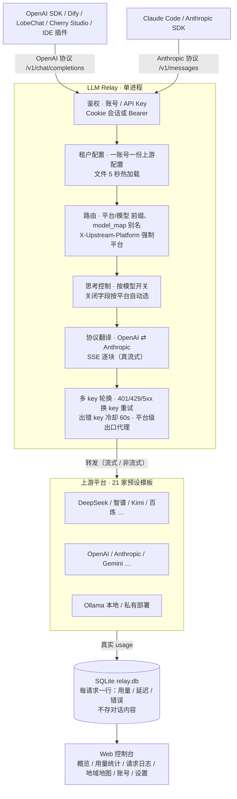

# 架构说明

> 模块图、请求流、关键设计决策、容量规划。部署细节（反代 / WSL / 证书）见 [DEPLOY.md](../DEPLOY.md)。

## 业务架构一览

一张图看全链路（与 README「架构一览」同步维护，改动请两边一起改）：



## 模块划分

```
app/
├── main.py       FastAPI 入口：/v1/* 网关路由 + 控制台托管 + 401 审计钩子
├── gateway.py    转发核心：路由解析 → 选 key → 翻译 → 发送（含重试/代理）→ 记账
├── translate.py  OpenAI ⇄ Anthropic 请求/响应/SSE 事件双向翻译（4 种协议组合）
├── registry.py   上游注册表：平台/模型 路由、model_map 别名、多 key 轮换与冷却、模型探测
├── tenants.py    多租户：一账号一份上游配置（config/tenants/u<id>/upstreams.json），5s 热加载
├── auth.py       账号体系：邮箱+密码（PBKDF2 哈希）、Cookie 会话、每账号多 Key、
│                 第二个账号起 magic link 确认（HMAC + 30 分钟时效 + pending 30 分钟自动清理）
├── storage.py    SQLite（WAL）：requests 表记账 + 聚合查询（平台/模型/天/协议/下游key/账号）
│                 启动自动「加列」迁移，旧库直接升级；ts 列 ISO 8601 本地时区
├── admin.py      管理 API（/api/*）：平台 CRUD + 21 家预设 + 统计端点 + 账号管理 + 邮件设置
├── mailer.py     确认邮件：三级优先级「控制台设置 > RELAY_SMTP_* 环境变量 > 日志模式」
├── geoip.py      双离线 GeoIP 定位：中国段优先 IP2Region xdb，境外/未命中落 GeoLite2 mmdb
├── ip2xdb.py     IP2Region xdb 纯 Python 二进制解析（零第三方依赖，中国精确到城市+运营商）
├── reasoning.py  思考控制：按模型开关，关闭字段按平台自动选（规则抄自各 provider 实测）
└── config.py     路径解析（RELAY_CONFIG_DIR / RELAY_DATA_DIR 等环境变量）+ 超时
```

## 一次请求的完整生命周期

```
下游客户端（OpenAI 或 Anthropic 协议）
   │  POST /v1/chat/completions 或 /v1/messages（可带 stream / tools / 思考字段）
   │  Authorization: Bearer ***
   ▼
main.py ── 鉴权（auth.authenticate）
   │        Bearer → 定位账号 + 记录 dkey_id（日志「下游 Key」列）；
   │        过期/被吊销 key：401 并写一条审计记录（带归属与原因）；
   │        无 key/无效 key：401 不落账（防刷日志）
   ▼
tenants.py ── 读该账号的上游配置（upstreams.json，mtime 5s 热加载）
   ▼
registry.py ── 路由解析
   │        model="平台/模型" → 指定平台 + 模型名（剥前缀，如 Google 的 models/ 前缀）
   │        model="裸名"     → 按配置顺序找第一个登记过它的平台（model_map 别名同样生效）
   │        X-Upstream-Platform 头 → 强制平台
   ▼
reasoning.py ── 按「平台/模型」查思考策略：off/low/high/跟随客户端
   │        off → 清掉客户端所有思考字段，再按平台写入正确的关闭字段
   │        （Ollama: think:false / 智谱: thinking.disabled / 百炼: enable_thinking:false /
   │          Gemini: thinking_budget=0 / 通用 OpenAI 兼容: reasoning_effort=none …）
   ▼
translate.py ── 协议翻译（仅当下游/上游协议不同时；参数线边界归一，
   │        如 reasoning_effort="max" 对非 OpenAI 官方上游降级 high）
   ▼
gateway.py ── 选 key（多 key 轮换，出错 key 冷却 60s）
   │        → 平台级出口代理（http/https/socks5/socks5h，独立 client 池）
   │        → httpx 流式转发（SSE 逐块，客户端断开自动收尾）
   │        → 401/429/5xx 自动换 key 重试
   ▼
storage.py ── 记账一条 requests 行：
             usage 优先取上游真实值（流式也主动索取，inject_stream_usage），
             拿不到才估算并 estimated=1；
             latency_ms / ttft_ms / cached_tokens / reasoning_tokens /
             上游原始错误文本 / 思考策略 / 所用 key（打码）
   ▼
SQLite data/relay.db  →  控制台「概览 / 用量统计 / 请求日志 / 地域地图」全部读它
```

## 关键设计决策（以及为什么）

| 决策 | 原因 |
| --- | --- |
| **必须单进程**（`workers=1`，compose 已锁死） | 统计库是 SQLite 单写者；key 轮换位置与冷却状态存在进程内存里。多副本各算各的。要横向扩需换 Postgres + Redis，见下方容量表 |
| **usage 精确优先** | 流式也主动向上游要 usage（OpenAI 兼容 `stream_options.include_usage`、Anthropic `stream` 事件）；拿不到才本地估算并落 `estimated=1`——统计口径透明，控制台 KPI 标注口径 |
| **配置 5s 热加载** | upstreams.json 改完不重启；但**新增配置字段**的旧代码会静默忽略（不报错也不生效）——升级代码后重启一次 |
| **零 CDN 单文件前端** | 控制台是内联 CSS/JS 的单个 index.html：内网/离线部署无外网依赖，无浏览器缓存分片问题 |
| **双 GeoIP 离线库 + 优雅降级** | 中国段 IP2Region xdb（纯 Python 解析，零依赖，精确到城市+运营商——免费 GeoLite2 对国内家宽常只到国家级）；境外落 GeoLite2 mmdb；两库任一缺失该面板显示配置提示，其余功能不受影响 |
| **SQLite 自动加列迁移** | 启动时 `PRAGMA table_info` 对比缺列自动 `ALTER TABLE ADD COLUMN`，旧库直接升级无需迁移脚本；schema 有变更的部署只需「容器启动时自动迁移，data/ 保留」 |

### 容量规划（实测基线）

中转站**不跑推理**，资源需求与 token 量几乎无关，只跟**并发连接数**和**请求条数**有关。
实测（Docker `python:3.12-slim`、128MB 限额、单进程）：

- 空载 RSS ≈ 60 MiB；**200 并发流式请求** 200/200 成功，RSS 峰值 76 MiB，无 OOM
- 经验公式：**内存 ≈ 60 MiB + 在途请求体总字节 × 1.8**（请求体 ≈ tokens × 3 字节）
- 磁盘 ≈ 请求条数 × 600 B（100 万请求 ≈ 600 MB）；删数据后要 `VACUUM` 才缩文件
- 128 MB 限额下能扛：典型 agent 请求（45 KB）750+ 并发 / 满 256K 上下文 ~35 并发 / 满 1M ~11 并发

推荐规格（个人 256 MB ~ 大组织 4 GB，详见 [DEPLOY.md §四](../DEPLOY.md#四容量规划与部署注意)）。

## 数据布局

```
config/
  tenants/u<账号id>/upstreams.json   每账号一份上游平台配置（明文 key，gitignore）
  settings.json                      运行时设置（base_path），可缺省
data/
  relay.db                           SQLite：users / api_keys / sessions / requests / meta
  IP2Region.xdb                      （可选）中国段定位，~11 MB
  GeoLite2-City.mmdb                 （可选）境外定位，MaxMind 免费账号下载
```

- `users.status`：`active` / `pending` / `disabled`；首个注册账号 = 管理员（豁免确认）
- `requests.user_id` 无外键约束：管理员彻底删除账号后历史行保留作审计
- `meta` 表存邮箱确认密钥（首用自动生成）与 SMTP 配置（页面设置优先于环境变量）
